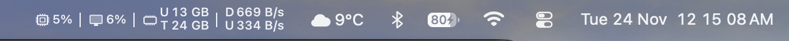

# SysMon — Your Mac, at a glance.

Made with Codex.

CPU, GPU, RAM, swap, network, and disk activity in your menu bar.

[Install](INSTALL.md#install-from-source) · [Update](INSTALL.md#update) · [Uninstall](INSTALL.md#uninstall) · [Troubleshooting](TROUBLESHOOTING.md)

Early development preview for **Apple Silicon · macOS 13+**. Install from source;
downloadable releases are planned.

## Make it yours

Choose the metrics you want, with text, mini graphs, or both. Open **Settings**
from the menu bar or launch SysMon again. Click **Save** to apply and close.

All metrics start hidden; use the **SM** menu to enable them. Refresh defaults
to **3 seconds**, and **Launch at Login** is optional.

## Follows your Mac

Native controls, system fonts, and transparent indicators follow your Mac’s
light or dark appearance. No theme to configure.

## Documentation

- [Installation, updates, and removal](INSTALL.md)
- [Troubleshooting and reading explanations](TROUBLESHOOTING.md)
- [Contributing, development, and bug reports](CONTRIBUTING.md)
- [Repository guidelines](AGENTS.md)
- [Contact](CONTACT.md)
